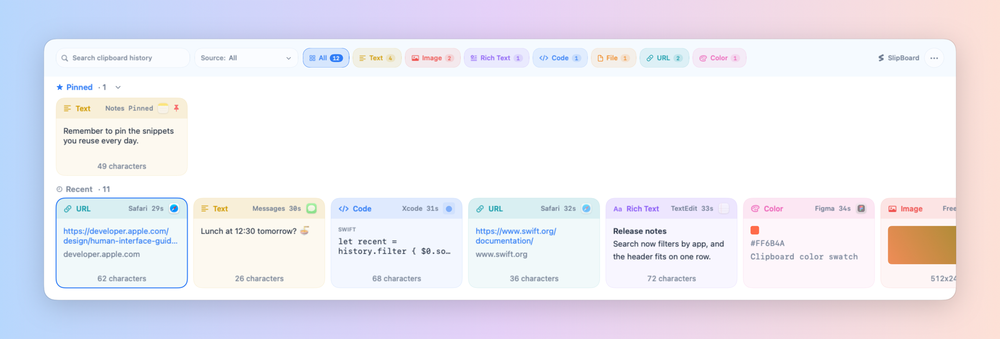
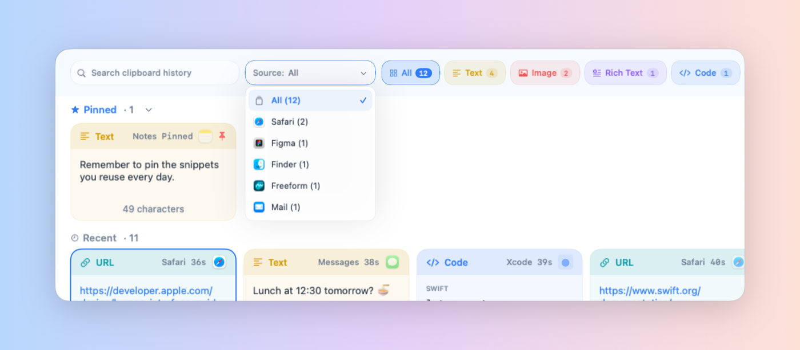
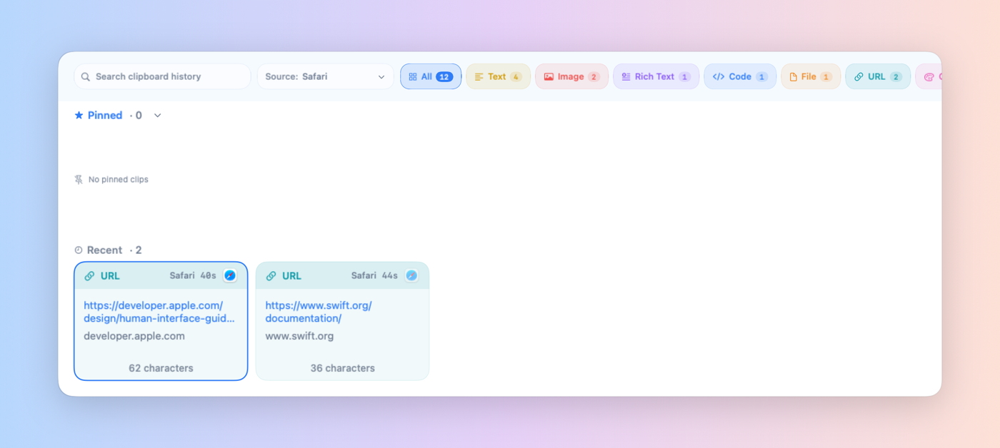
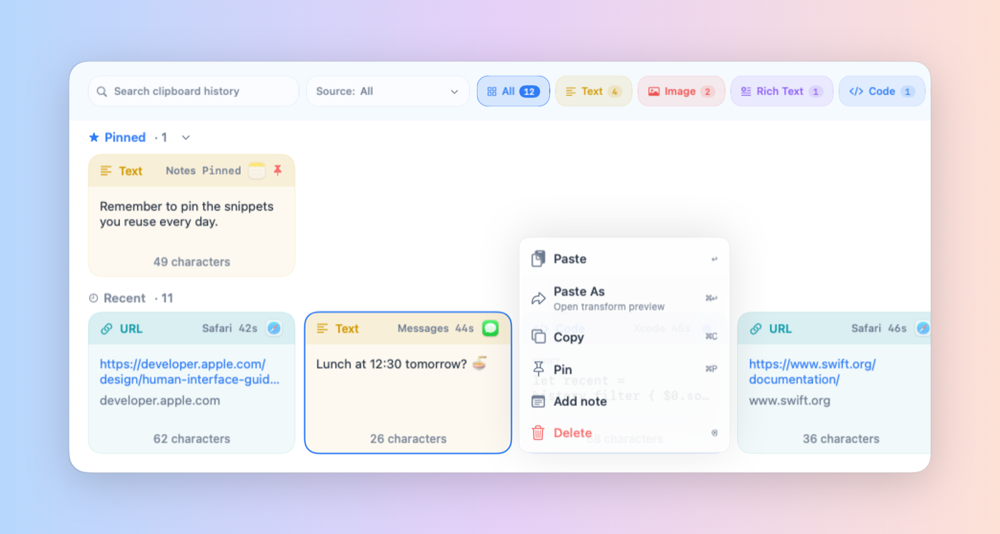
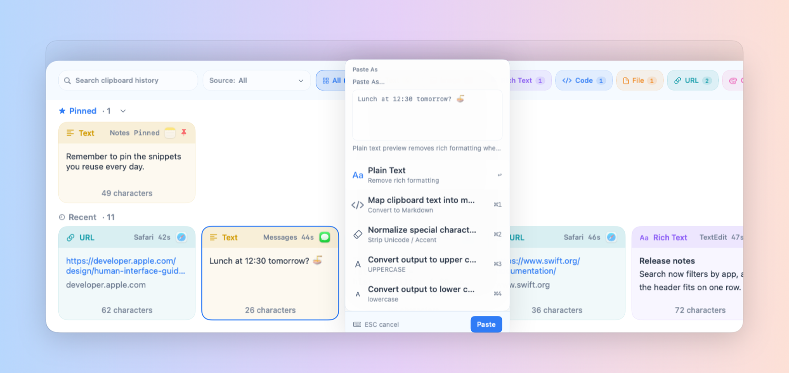
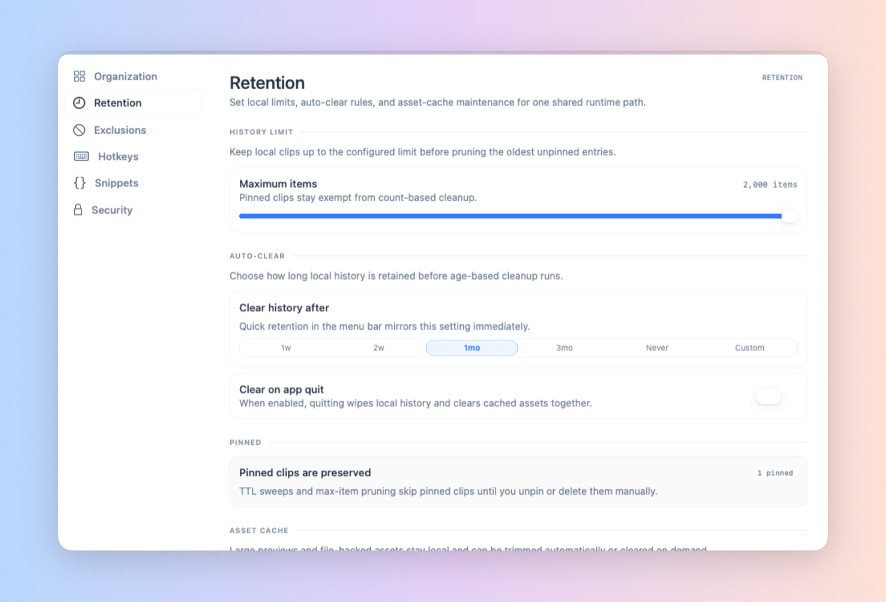
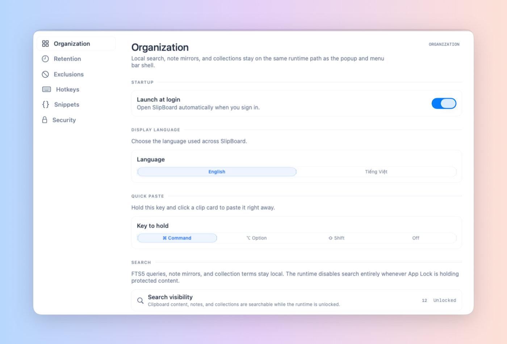
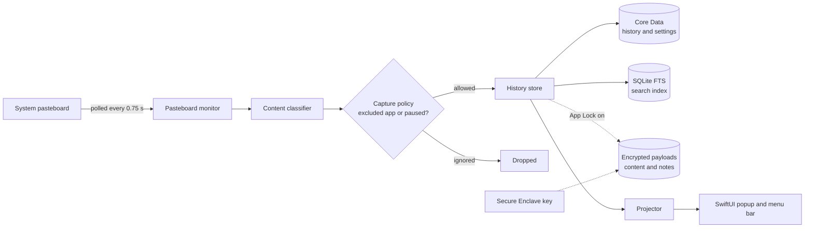

<div align="center">


# SlipBoard

**A fast, private clipboard manager that lives in your macOS menu bar**

Press a hotkey, pick what you copied recently, paste it.


[](LICENSE)

[](README.md)
[](README.en.md)

<picture>
  <source media="(prefers-color-scheme: dark)" srcset="docs/images/popup-en-dark.png">
  
</picture>

</div>

---

## Overview

SlipBoard watches the system clipboard and keeps a searchable history of
everything you copy: text, code, links, colors, images, files and rich text. A
global hotkey opens a popup with your **Pinned** and **Recent** items. Pick one
with the keyboard and SlipBoard pastes it into the app you were just using.

### Why SlipBoard?

- **Private by design:** no analytics, no telemetry, no account. The only
  network connection is the update check.
- **Fast and light:** a pure SwiftUI app that lives in the menu bar and opens
  with one hotkey.
- **Paste it your way:** paste the original, or transform it on the way in
  (plain text, Markdown, strip accents, upper or lower case).
- **In your control:** exclude sensitive apps, pause capture, limit how long
  history is kept, lock it with Touch ID.

---

## Highlights

### Everything on one row

The search field, the **Source** menu and the type filters share a single row
above the **Pinned** and **Recent** rails. Each card shows the kind of content,
the app it came from (with its real icon), when you copied it and how big it is.

### Filter by source app

Open the **Source** menu to see only what came from one app. It lists the apps
you copy from most with their counts; the selected app is highlighted and moved
right under **All**.

<p align="center">
  
  
</p>

### Actions right on the card

Right-click (or `⌃`-click) a card to paste it, paste it as something else, copy,
pin, add a note or delete it. Hold `⌘` and click to paste right away.

<p align="center">
  
</p>

### Paste as something else

Press `⌘↩` to preview and pick how to paste: plain text, Markdown, without
accents, UPPERCASE or lowercase.

<p align="center">
  
</p>

### You decide how long to keep things

Cap the number of items, choose how long to keep them (1 week to forever, or a
custom number of hours, days, weeks or months) and clear history on quit.
Pinned items are never cleaned up.

<p align="center">
  
</p>

### Settings in one place

Launch at login, switch the language (English / Tiếng Việt), pick the quick
paste key, exclude apps, set hotkeys, snippets and App Lock.

<p align="center">
  
</p>

> Screenshots use sample data.

---

## Features

### 1. Capture everything you copy

- Detects **text, rich text, code, URLs, colors, images and files**
  automatically.
- Every card shows the **real icon of the app** it came from, plus its name
  and how long ago you copied it.
- The footer of each card tells you the size of the content at a glance:

| Kind | Footer shows | Example |
| --- | --- | --- |
| Text, code, URL, rich text | Character count | `1,250 characters` |
| Image | Pixel dimensions | `512x246` |
| File | Size on disk (summed for several files) | `2.5 MB` |

- Copying something you already have moves it to the front instead of adding a
  duplicate.
- Items that arrive from your iPhone, iPad or another Mac through Universal
  Clipboard (Handoff) are labelled as such.

### 2. Find, filter and organize

The popup has two rails of cards: **Pinned** (top) and **Recent**. Above them
sit the filter bar and the search box. The type filter, the source filter
and the search query all work **together**.

#### Filter by type

Each filter button shows how many items it matches.

| Filter | What it covers |
| --- | --- |
| All | Your entire history |
| Text | Plain text |
| Image | Screenshots, images copied from a browser or an app |
| Rich Text | Formatted text (RTF, HTML); shown only when your history has some |
| Code | Code snippets, detected automatically |
| File | One or more files |
| URL | Links |
| Color | Color values such as `#ff8800`; shown only when your history has some |

#### Filter by source

Every card shows **which app** it came from: the app's real icon, its name and
how long ago you copied it. To see only what came from one app:

- Open the **Source** menu in the filter bar. It lists the apps you copy from
  most (up to 8) with the number of items from each. Pick an app and the popup
  shows only its items; pick **All** to clear the filter.
- The source filter works **together** with the type filter and search, for
  example pick **Image** and then the source **Safari**. If
  every item from that app is deleted or cleaned up, the filter returns to
  **All** by itself.
- An app outside the top 8 can still be found: type its name (for example
  `Slack`) into the search box, since the source app name is part of the search
  index.
- While App Lock is locked, the Source menu is hidden so app names are not
  revealed.
- Items that arrive from your iPhone, iPad or another Mac through **Universal
  Clipboard** (Handoff) are labelled so you can tell them apart from what you
  copied on this Mac.
- To **never record** anything from an app, add it under
  **Settings → Exclusions** (see section 4). An extra option can also hide the
  popup while you are inside that app.

#### Full-text search

- Just **type any character** while the popup is open, or press `⌘/`.
- **Case- and accent-insensitive**: `viet` still finds `Việt`.
- Searches the clip content, its metadata (file names, sizes, ...), the source
  app name and your **notes**.
- For very long text only the beginning is indexed, which keeps locking,
  unlocking and copying fast.
- While App Lock is locked, search is disabled until you unlock.

#### Pins and notes

- **Pin** an item to keep it in the **Pinned** rail. Pinned items are never
  cleaned up by the item limit or by age. **Hide/Show pinned** collapses the
  rail to give Recent more room.
- Attach a **note** to an item to remember why you kept it; notes are
  searchable too.

#### Card actions

| Action | Result |
| --- | --- |
| Click | Select the card |
| Double-click | Paste the card into the app you were using |
| `⌘` + click | **Quick paste**: select and paste immediately. Change it to `⌥` or `⇧`, or turn it off, in **Settings → Organization → Quick paste** |
| Right-click, or `⌃` + click | Open the card's action menu: Paste, Paste As, Copy, Pin/Unpin, Note, Delete |

### 3. Paste how you want

| Paste as | Result |
| --- | --- |
| Original | Pasted exactly as copied |
| Plain text | Formatting removed |
| Markdown | Text mapped into Markdown-friendly output |
| Strip Unicode / accents | Accents removed, special characters normalized |
| UPPERCASE / lowercase | Changes the letter case |

- Paste and close the popup, or paste and **keep it open** to paste several
  items in a row.
- **Snippets:** reusable text, created and edited in **Settings → Snippets**. Give each snippet a global hotkey; press it in any app to paste the snippet there.

### 4. Control what is recorded

- **Exclude apps** from capture (for example a password manager).
- **Pause capture** for 15 minutes, 1 hour, or until you resume.
- **Retention:** keep up to 2,000 items (adjustable with a slider) for 1 week,
  2 weeks, 1 month, 3 months, forever, or a **custom period** (1-999 hours,
  days, weeks or months). Pinned items are never cleaned up. Optionally clear
  history when the app quits.
- **Move pasted item to top:** optionally move an item to the front of Recent
  after you paste it.

### 5. App Lock

- Locks within a session only: SlipBoard opens unlocked after launch or
  reinstall, then locks when you choose Lock or after the auto-lock timeout.
- Unlock with **Touch ID** or your system password.
- Lock automatically after 1 minute, 5 minutes, 15 minutes or 1 hour of
  inactivity.
- While locked, content is hidden in the popup, including the length and size
  of each card; app icons are replaced by a lock glyph.
- Optionally hide previews in Mission Control / Exposé.

### 6. Made for the Mac

- Light, dark or follow-system appearance, with **Liquid Glass** styling on
  macOS 26 and a standard theme on earlier versions.
- **English** and **Tiếng Việt** interface.
- A dedicated menu bar icon. Click it to see capture status, pause capture,
  change retention quickly, or open the popup or Settings.
- Optional **launch at login** and customizable global hotkeys.
- **Settings → About** shows the version and checks for updates. SlipBoard
  downloads, verifies and installs a new version itself (Sparkle).

---

## Keyboard shortcuts

The global hotkey opens the popup from anywhere (default **⌘⇧V**, changeable
in Settings → Hotkeys). Inside the popup:

| Key | Action |
| --- | --- |
| `←` `→` / `↑` `↓` | Move between items |
| `Tab` / `⇧Tab` | Next / previous item |
| `↩` | Paste the selected item and close the popup |
| `⌥↩` | Paste and keep the popup open |
| `⌘↩` | Open the **Paste As** menu (plain text, Markdown, …) |
| `⌫` | Delete the selected item |
| `⌘/` or *any character* | Start searching |
| `esc` | Close the popup |

---

## Privacy and security

- **Offline except for update checks.** SlipBoard connects only to GitHub, to
  check for updates: when you click **Check for Updates**, or daily if you
  allow automatic checks when it asks on the second launch (change it in
  Settings → About). Nothing about your
  Mac or your clipboard is sent. No analytics, no telemetry, no crash-reporting
  service, no account or sign-in.
- **Library validation is off in releases.** Without an Apple Team ID, macOS
  only loads `Sparkle.framework` into the app if library validation is turned
  off. The hardened runtime still blocks `DYLD_*` injection, and macOS protects
  apps in `/Applications` from changes by other apps, so install SlipBoard
  there.
- **Local storage only.** History, notes, snippets and settings live in
  `~/Library/Application Support/SlipBoard/` on your Mac.
- **App Lock locks the window, not the disk.** It hides your history until you
  unlock with Touch ID or your system password. Clip text, long-text files and
  copied images are stored unencrypted in the folder above, so use FileVault
  to protect them at rest.
- **Notes are encrypted, but on release builds the key sits next to them.**
  With App Lock on, notes and a copy of clip content are encrypted. Release
  builds (signed with SlipBoard's own certificate, or ad-hoc) keep that key
  in `PayloadKey.json` in the same folder,
  readable only by your user account, so anyone who can read your files can
  read the key too: this only keeps notes out of casual view. Team-signed
  builds keep the key in the keychain instead.
- **Everything you copy is recorded,** including passwords copied from a
  password manager. Exclude that app in Settings, or pause capture, to keep
  them out of the history.
- **One permission: Accessibility.** It is used only to send the ⌘V keystroke
  when you pick an item. SlipBoard does not log or transmit keystrokes.

Read the full policy in [PRIVACY.md](PRIVACY.md).

---

## Installation

### Requirements

- **macOS 15** or later to run.
- **Xcode 26** to build. The project uses macOS 26 SDK APIs (Liquid Glass)
  behind availability checks, even though it runs back to macOS 15.

### Install from a release

Download `SlipBoard.dmg` from [Releases](../../releases), open it and drag
**SlipBoard** into **Applications**.

Releases are signed with SlipBoard's own self-signed certificate and are not
notarized, so macOS blocks the first launch:

1. Open SlipBoard. macOS says it cannot verify the app; click **Done**.
2. Open **System Settings → Privacy & Security**, scroll to **Security** and
   click **Open Anyway** next to SlipBoard, then confirm.

Then grant **Accessibility** access when asked so SlipBoard can paste into
other apps.

Updates keep the Accessibility permission: every release since
v1.0-20261016.2 is signed with the same certificate, so macOS sees an update as
the same app. App Lock does not ask for keychain access after an update either:
release builds keep its key in a file (see
[Privacy and security](#privacy-and-security)).

> [!IMPORTANT]
> **Updating from v1.0-20261016 or earlier?** Those builds were signed
> differently, so grant Accessibility one last time: in **System Settings →
> Privacy & Security → Accessibility**, remove SlipBoard with **−**, then
> reopen SlipBoard and allow it when asked.
>
> **Updating from v1.0-20261016 with App Lock on?** That release kept the App
> Lock key in the login keychain. The first launch of a newer release asks
> once to use “com.slipboard.security.payload-key”: enter your login password
> and allow it, and SlipBoard moves the key into its file so your notes stay
> readable. Later updates do not ask again. If you deny it, SlipBoard stays
> locked; choose Unlock to be asked again. macOS may not let SlipBoard delete
> the old keychain items; after the move you can delete the
> `com.slipboard.security.payload-key` items in **Keychain Access** yourself.
>
> **Coming from an earlier release with App Lock on?** Its key belongs to the
> old signature and cannot be read by an ad-hoc build, so SlipBoard creates a
> new one on first launch. Notes saved under the old key cannot be read
> anymore; clip history is not affected.

### Build from source

**Quick build (no Apple Developer account needed)**: this is the same command
the CI runs.

```bash
xcodebuild \
  -project SlipBoard.xcodeproj \
  -target SlipBoard \
  -configuration Debug \
  CODE_SIGNING_ALLOWED=NO \
  build
```

An unsigned build runs. For App Lock, use the ad-hoc build from
[Packaging a release](#packaging-a-release), which needs no account either.

**Team-signed build**

A team-signed build keeps the App Lock key in the Data Protection keychain,
wrapped by a Secure Enclave key when the Mac has one. Ad-hoc builds cannot carry
the keychain entitlement, so they keep it in a file only your user can read,
next to the encrypted data.

1. In Xcode, open `SlipBoard.xcodeproj`, select the **SlipBoard** target and
   set **Signing & Capabilities** to your own team. Change the bundle
   identifier to one you own.
2. Build, letting Xcode create the provisioning profile:

   ```bash
   xcodebuild \
     -project SlipBoard.xcodeproj \
     -scheme SlipBoard \
     -configuration Release \
     -allowProvisioningUpdates \
     build
   ```

   The profile is required because `keychain-access-groups`
   ([`SlipBoard.entitlements`](SlipBoard.entitlements)) is a restricted
   entitlement. Without it, building fails with
   `No profiles for '<bundle id>' were found`.

### Packaging a release

`build_release.sh` builds the Release configuration and packages it as a DMG:

```bash
./build_release.sh              # signed with SIGN_IDENTITY if set (releases), else ad-hoc
./build_release.sh --team       # team-signed build, needs a provisioning profile
./build_release.sh --no-sign    # unsigned build, like CI
```

Output goes to `Release/`: `SlipBoard.app`, `SlipBoard.dmg` and
`SlipBoard.dmg.sha256`. The DMG opens a window that shows dragging SlipBoard
onto Applications; the script asks Finder to lay it out, so the first run asks
to let your terminal control Finder. The background comes from
`Tools/dmg/make-background.swift`. You can set `DEVELOPMENT_TEAM`, `SIGN_IDENTITY` and
`NOTARY_PROFILE` in a `.env` file (see [`.env.example`](.env.example)).
Notarization only runs when the app is signed with a **Developer ID**
certificate.

**Release signing.** Official releases are signed with the maintainer's
self-signed code signing certificate, set as `SIGN_IDENTITY` in `.env`, so
macOS keeps the Accessibility permission across updates. Only a Mac that holds
that certificate and its private key can build a release; CI and forks build
ad-hoc. A release signed with any other certificate counts as a new app, and
every user has to grant Accessibility again, so keep a backup of the
certificate with its private key. Gatekeeper still asks for **Open Anyway** on
first launch.

To sign your own builds the same way, create a certificate in **Keychain
Access → Certificate Assistant → Create a Certificate…** (**Identity Type**:
Self-Signed Root, **Certificate Type**: Code Signing) and put its name or
SHA-1 hash in `SIGN_IDENTITY`.

`BUILD_DATE` overrides the build number, for example `BUILD_DATE=20261016.2`
for a second release on the same day.

**In-app updates.** SlipBoard updates itself with
[Sparkle](https://sparkle-project.org). A build signed with `SIGN_IDENTITY` also
writes `Release/appcast.xml`, signing the DMG with the Sparkle EdDSA private key
in your login keychain (`generate_keys` in
`build/SourcePackages/artifacts/sparkle/Sparkle/bin/` creates one). Upload
`appcast.xml` to the GitHub release next to the DMG: the app reads
`releases/latest/download/appcast.xml`. Sparkle installs a release only when its
build number is higher than the installed one, and only when the DMG matches the
`SUPublicEDKey` in [`SlipBoard-Info.plist`](SlipBoard-Info.plist), so a fork must
replace that key and `SUFeedURL` with its own. Self-signed builds carry the
`com.apple.security.cs.disable-library-validation` entitlement: without a Team
ID, macOS refuses to load `Sparkle.framework` otherwise.

Release naming: tag `v<version>-<yyyymmdd>`, title
`SlipBoard v<version> (Build <yyyymmdd>)`, and a **What's New** section as the
description.

---

## How it works



The app is a SwiftUI menu-bar app with an AppKit panel for the popup. The
history store is the single source of truth. The projector turns it into the
view state the popup renders, while Core Data persistence and the SQLite
full-text index are kept in sync from it. With App Lock on, a copy of the
content and notes of each item is additionally written to an encrypted store.
Its key is wrapped by the Secure Enclave in team-signed builds (when the Mac
has one) and kept in a file readable only by your user in release and ad-hoc
builds. The Core Data store itself is not encrypted.

## Project layout

```text
SlipBoard/
├── Core/         Application logic, one folder per area
│   ├── ClipboardHistory/         pasteboard monitor, classifier, store, projector
│   ├── SearchNotesOrganization/  search index, notes, collections
│   ├── SecurityAppLock/          Secure Enclave key, encrypted payloads, lock state
│   ├── RetentionSettings/        Core Data persistence and cleanup
│   ├── PasteActions/             paste and paste-as transforms
│   ├── SnippetsHotkeys/          snippets and global hotkeys
│   ├── ExclusionsPause/          excluded apps and pause timers
│   └── Localization/             English / Tiếng Việt catalog
├── Models/       Value types shared across the app
├── UI/           SwiftUI views: popup shell, menu bar, settings, themes
└── SlipBoardApp.swift            app entry point and runtime wiring
Tools/
└── LocalizationHarness/          standalone harness to test the string catalog
build_release.sh                  build and package a DMG
```

## Known limitations

- Items are always listed newest first; there is no other sort order yet.
- Rich-text formatting is kept only while the app is running. After a restart
  the item is still in your history as plain text.
- File sizes and image dimensions are read when a card is shown: if a file has
  been moved or deleted, its footer stays empty.

## License

Released under the [MIT License](LICENSE).

## Third-party notices

SlipBoard bundles one third-party library:

- **[Sparkle](https://sparkle-project.org)** 2, the in-app update framework
  (MIT License; © 2006-2013 Andy Matuschak, © 2009-2013 Elgato Systems GmbH,
  © 2011-2014 Kornel Lesiński, © 2015-2017 Mayur Pawashe, © 2014 C.W. Betts,
  © 2014 Petroules Corporation, © 2014 Big Nerd Ranch). Sparkle includes code
  from bsdiff, sais-lite, ed25519 and SUSignatureVerifier under their own
  licenses. Full text:
  [Sparkle's LICENSE](https://github.com/sparkle-project/Sparkle/blob/2.10.0/LICENSE).

It bundles no other third-party code, fonts or artwork, and relies on these:

- **SF Symbols** (© Apple Inc.). The interface draws icons from the SF Symbols
  set that macOS provides, as allowed by Apple's SF Symbols license for apps on
  Apple platforms. No symbol is used in the app icon or logo.
- **San Francisco** (© Apple Inc.). Text, including the DMG background, uses the
  macOS system font, which is not bundled.
- **App icon and menu bar icon.** Made for SlipBoard with an AI image tool; they
  contain no third-party artwork.
- **Other apps' names and icons.** Cards show the name and icon of the app a
  clip came from, read from your Mac at run time. The screenshots in this README
  show some of them for illustration only. They are trademarks of their owners.
