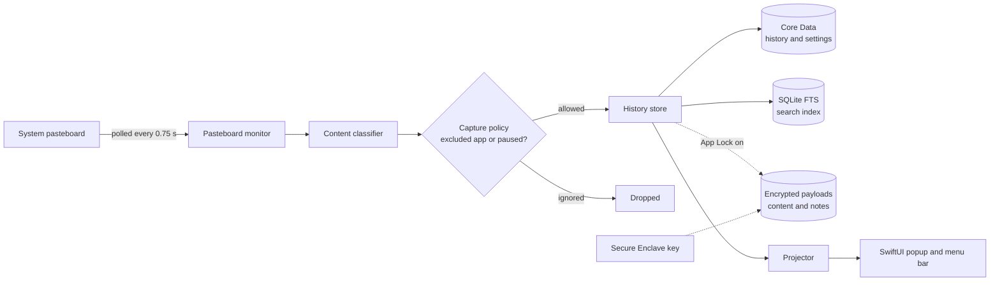

<div align="center">


# SlipBoard

**A fast, private clipboard manager that lives in your macOS menu bar**

Press a hotkey, pick what you copied recently, paste it.


[](README.md)
[](README.en.md)

<picture>
  <source media="(prefers-color-scheme: dark)" srcset="docs/images/popup-en-dark.png">
  
</picture>

</div>

---

## Overview

SlipBoard watches the system clipboard and keeps a searchable history of
everything you copy: text, code, links, colors, images, files and rich text. A
global hotkey opens a popup with your **Pinned** and **Recent** items. Pick one
with the keyboard and SlipBoard pastes it into the app you were just using.

### Why SlipBoard?

- **Private by design:** no networking code, no analytics, no telemetry, no
  account.
- **Fast and light:** a pure SwiftUI app that lives in the menu bar and opens
  with one hotkey.
- **Paste it your way:** paste the original, or transform it on the way in
  (plain text, Markdown, strip accents, upper or lower case).
- **In your control:** exclude sensitive apps, pause capture, limit how long
  history is kept, lock it with Touch ID.

---

## Features

### 1. Capture everything you copy

- Detects **text, rich text, code, URLs, colors, images and files**
  automatically.
- Every card shows the **real icon of the app** it came from, plus its name
  and how long ago you copied it.
- The footer of each card tells you the size of the content at a glance:

| Kind | Footer shows | Example |
| --- | --- | --- |
| Text, code, URL, rich text | Character count | `1,250 characters` |
| Image | Pixel dimensions | `512x246` |
| File | Size on disk (summed for several files) | `2.5 MB` |

- Copying something you already have moves it to the front instead of adding a
  duplicate.
- Items that arrive from your iPhone, iPad or another Mac through Universal
  Clipboard (Handoff) are labelled as such.

### 2. Find and organize

- **Pinned** and **Recent** rails, with filters by type.
- Full-text search across your whole history: just start typing while the
  popup is open.
- Attach a **note** to any item and sort items into custom **collections**.

### 3. Paste how you want

| Paste as | Result |
| --- | --- |
| Original | Pasted exactly as copied |
| Plain text | Formatting removed |
| Markdown | Text mapped into Markdown-friendly output |
| Strip Unicode / accents | Accents removed, special characters normalized |
| UPPERCASE / lowercase | Changes the letter case |

- Paste and close the popup, or paste and **keep it open** to paste several
  items in a row.
- **Snippets:** reusable text, each with its own global hotkey.

### 4. Control what is recorded

- **Exclude apps** from capture (for example a password manager).
- **Pause capture** for 15 minutes, 1 hour, or until you resume.
- **Retention:** keep up to 2,000 items for 1 week, 2 weeks, 1 month, 3 months
  or forever. Pinned items are never cleaned up. Optionally clear history when
  the app quits.

### 5. App Lock

- Unlock with **Touch ID** or your system password.
- Lock automatically after 1 minute, 5 minutes, 15 minutes or 1 hour of
  inactivity.
- While locked, content is hidden in the popup, including the length and size
  of each card; app icons are replaced by a lock glyph.
- Optionally hide previews in Mission Control / Exposé.

### 6. Made for the Mac

- Light, dark or follow-system appearance, with **Liquid Glass** styling on
  macOS 26 and a standard theme on earlier versions.
- **English** and **Tiếng Việt** interface.
- Optional launch at login and customizable global hotkeys.

---

## Keyboard shortcuts

The global hotkey opens the popup from anywhere (default **⌘⇧V**, changeable
in Settings → Hotkeys). Inside the popup:

| Key | Action |
| --- | --- |
| `←` `→` / `↑` `↓` | Move between items |
| `Tab` / `⇧Tab` | Next / previous item |
| `↩` | Paste the selected item and close the popup |
| `⌥↩` | Paste and keep the popup open |
| `⌘↩` | Open the **Paste As** menu (plain text, Markdown, …) |
| `⌫` | Delete the selected item |
| *any character* | Start searching |
| `esc` | Close the popup |

---

## Privacy and security

- **Fully offline.** SlipBoard contains no networking code, no analytics, no
  telemetry and no crash-reporting service. There is no account or sign-in.
- **Local storage only.** History, notes, snippets and settings live in
  `~/Library/Application Support/SlipBoard/` on your Mac.
- **App Lock encrypts item content on disk.** When enabled, the content and
  notes of your items are stored encrypted with a key protected by the Secure
  Enclave (Keychain as a fallback), unlocked with Touch ID or your system
  password.
- **One permission: Accessibility.** It is used only to send the ⌘V keystroke
  when you pick an item. SlipBoard does not log or transmit keystrokes.

Read the full policy in [PRIVACY.md](PRIVACY.md).

---

## Installation

### Requirements

- **macOS 15** or later to run.
- **Xcode 26** to build. The project uses macOS 26 SDK APIs (Liquid Glass)
  behind availability checks, even though it runs back to macOS 15.

### Install from a release

Download `SlipBoard.dmg` from [Releases](../../releases), open it and drag
**SlipBoard** into **Applications**. On first launch, grant **Accessibility**
access when asked so SlipBoard can paste into other apps.

> [!NOTE]
> Current builds are signed with a development certificate (Apple Development),
> are not notarized, and only run on the devices listed in that build's
> provisioning profile. If a release will not open on your Mac, build from
> source below.

### Build from source

**Quick build (no Apple Developer account needed)**: this is the same command
the CI runs.

```bash
xcodebuild \
  -project SlipBoard.xcodeproj \
  -target SlipBoard \
  -configuration Debug \
  CODE_SIGNING_ALLOWED=NO \
  build
```

An unsigned build runs, but **App Lock cannot be enabled in it**: storing the
protection key needs the keychain entitlement, which only a signed build has.

**Signed build (needed for App Lock)**

1. In Xcode, open `SlipBoard.xcodeproj`, select the **SlipBoard** target and
   set **Signing & Capabilities** to your own team. Change the bundle
   identifier to one you own.
2. Build, letting Xcode create the provisioning profile:

   ```bash
   xcodebuild \
     -project SlipBoard.xcodeproj \
     -scheme SlipBoard \
     -configuration Release \
     -allowProvisioningUpdates \
     build
   ```

   The profile is required because `keychain-access-groups`
   ([`SlipBoard.entitlements`](SlipBoard.entitlements)) is a restricted
   entitlement. Without it, building fails with
   `No profiles for '<bundle id>' were found`.

### Packaging a release

`build_release.sh` builds the Release configuration and packages it as a DMG:

```bash
./build_release.sh              # signed build (needed for App Lock)
./build_release.sh --no-sign    # unsigned build, like CI
```

Output goes to `Release/`: `SlipBoard.app`, `SlipBoard.dmg` and
`SlipBoard.dmg.sha256`. You can set `DEVELOPMENT_TEAM` and `NOTARY_PROFILE` in
a `.env` file (see [`.env.example`](.env.example)). Notarization only runs when
the app is signed with a **Developer ID** certificate.

Release naming: tag `v<version>-<yyyymmdd>`, title
`SlipBoard v<version> (Build <yyyymmdd>)`, and a **What's New** section as the
description.

---

## How it works



The app is a SwiftUI menu-bar app with an AppKit panel for the popup. The
history store is the single source of truth. The projector turns it into the
view state the popup renders, while Core Data persistence and the SQLite
full-text index are kept in sync from it. With App Lock on, the content and
notes of each item are additionally written to an encrypted store whose key is
held by the Secure Enclave.

## Project layout

```text
SlipBoard/
├── Core/         Application logic, one folder per area
│   ├── ClipboardHistory/         pasteboard monitor, classifier, store, projector
│   ├── SearchNotesOrganization/  search index, notes, collections
│   ├── SecurityAppLock/          Secure Enclave key, encrypted payloads, lock state
│   ├── RetentionSettings/        Core Data persistence and cleanup
│   ├── PasteActions/             paste and paste-as transforms
│   ├── SnippetsHotkeys/          snippets and global hotkeys
│   ├── ExclusionsPause/          excluded apps and pause timers
│   └── Localization/             English / Tiếng Việt catalog
├── Models/       Value types shared across the app
├── UI/           SwiftUI views: popup shell, menu bar, settings, themes
└── SlipBoardApp.swift            app entry point and runtime wiring
Tools/
└── LocalizationHarness/          standalone harness to test the string catalog
build_release.sh                  build and package a DMG
design/                           design docs and UI contracts
```

## Known limitations

- Rich-text formatting is kept only while the app is running. After a restart
  the item is still in your history as plain text.
- File sizes and image dimensions are read when a card is shown: if a file has
  been moved or deleted, its footer stays empty.

## License

All rights reserved.
