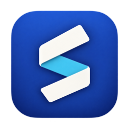
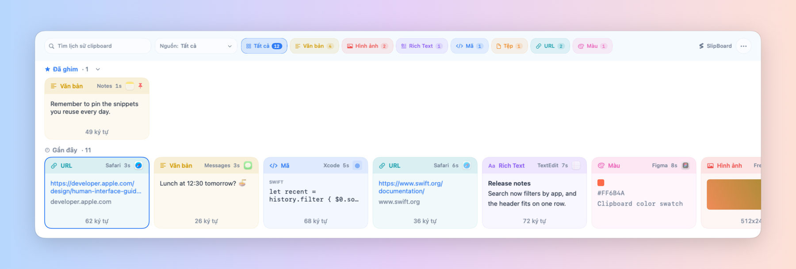
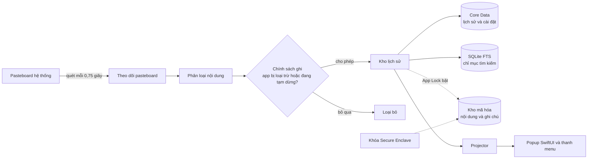

<div align="center">



# SlipBoard

**Trình quản lý clipboard nhanh, riêng tư, nằm gọn trên thanh menu macOS**

Nhấn phím tắt, chọn thứ bạn vừa sao chép, dán.


[](LICENSE)

[](README.md)
[](README.en.md)

<picture>
  <source media="(prefers-color-scheme: dark)" srcset="docs/images/popup-vi-dark.png">
  
</picture>

</div>

---

## Giới thiệu

SlipBoard theo dõi clipboard của hệ thống và lưu lại một lịch sử có thể tìm
kiếm của mọi thứ bạn sao chép: văn bản, code, liên kết, màu sắc, hình ảnh, file
và văn bản có định dạng. Một phím tắt toàn cục mở popup với các mục **Đã ghim**
và **Gần đây**. Chọn một mục bằng bàn phím, SlipBoard sẽ dán nó vào ứng dụng bạn
vừa dùng.

### Vì sao chọn SlipBoard?

- **Riêng tư tuyệt đối:** không có code kết nối mạng, không analytics, không
  telemetry, không cần tài khoản.
- **Nhanh và gọn:** ứng dụng SwiftUI thuần, sống trên thanh menu, mở bằng một
  phím tắt.
- **Dán đúng cách bạn muốn:** dán nguyên bản, hoặc chuyển đổi ngay lúc dán
  (plain text, Markdown, bỏ dấu, chữ hoa, chữ thường).
- **Kiểm soát được:** loại trừ ứng dụng nhạy cảm, tạm dừng ghi, giới hạn thời
  gian lưu, khóa bằng Touch ID.

---

## Tính năng chính

### 1. Ghi lại mọi thứ bạn sao chép

- Nhận diện tự động **văn bản, văn bản có định dạng, code, URL, màu, hình ảnh
  và file**.
- Mỗi thẻ hiển thị **logo thật của ứng dụng nguồn** cùng tên và thời gian.
- Chân thẻ cho biết nhanh kích thước của nội dung:

| Loại | Chân thẻ hiển thị | Ví dụ |
| --- | --- | --- |
| Văn bản, code, URL, văn bản có định dạng | Số ký tự | `1.250 ký tự` |
| Hình ảnh | Kích thước điểm ảnh | `512x246` |
| File | Dung lượng (cộng dồn nếu nhiều file) | `2.5 MB` |

- Sao chép lại thứ đã có sẽ đưa nó lên đầu thay vì tạo bản trùng.
- Nội dung đến từ iPhone, iPad hoặc máy Mac khác qua Universal Clipboard
  (Handoff) được gắn nhãn riêng.

### 2. Tìm, lọc và sắp xếp

Popup chia làm hai hàng thẻ: **Đã ghim** (ở trên) và **Gần đây**. Phía trên là
thanh lọc và ô tìm kiếm; bốn thứ này dùng được **cùng lúc**: bộ lọc theo loại,
nguồn, nhóm trong bộ sưu tập và từ khóa tìm kiếm.

#### Bộ lọc theo loại

Mỗi nút lọc hiện kèm **số lượng** mục tương ứng.

| Bộ lọc | Gồm những gì |
| --- | --- |
| Tất cả | Toàn bộ lịch sử |
| Văn bản | Văn bản thuần |
| Hình ảnh | Ảnh chụp màn hình, ảnh sao chép từ trình duyệt hoặc ứng dụng |
| Rich Text | Văn bản có định dạng (RTF, HTML); chỉ hiện khi lịch sử có mục loại này |
| Code | Đoạn code, được nhận diện tự động |
| File | Một hoặc nhiều file |
| URL | Liên kết |
| Màu | Mã màu như `#ff8800`; chỉ hiện khi lịch sử có mục loại này |

#### Lọc theo nguồn

Mỗi thẻ cho biết nó đến từ **ứng dụng nào**: logo thật của ứng dụng cùng tên
và thời gian sao chép. Để chỉ xem những gì đến từ một ứng dụng:

- Mở menu **Nguồn** trên thanh lọc. Menu liệt kê các ứng dụng đã sao chép nhiều
  nhất (tối đa 8), kèm số mục của từng ứng dụng. Chọn một ứng dụng để popup chỉ
  còn các mục từ ứng dụng đó, chọn **Tất cả** để bỏ lọc.
- Bộ lọc nguồn dùng được **cùng lúc** với bộ lọc loại, tìm kiếm và bộ sưu tập,
  ví dụ lọc **Hình ảnh** rồi chọn nguồn **Safari**. Nếu mọi mục của ứng dụng đó
  bị xóa hoặc bị dọn, bộ lọc tự quay về **Tất cả**.
- Ứng dụng không nằm trong 8 mục đầu vẫn tìm được: gõ tên ứng dụng (ví dụ
  `Slack`) vào ô tìm kiếm, vì tên ứng dụng nguồn nằm trong chỉ mục tìm kiếm.
- Khi App Lock đang khóa, menu Nguồn bị ẩn để không lộ tên ứng dụng.
- Nội dung đến từ iPhone, iPad hoặc máy Mac khác qua **Universal Clipboard**
  (Handoff) được gắn nhãn riêng để phân biệt với thứ bạn copy trên máy này.
- Muốn **không bao giờ ghi** nội dung từ một ứng dụng, thêm nó vào
  **Cài đặt → Loại trừ** (xem mục 4). Tùy chọn kèm theo có thể ẩn luôn popup
  khi bạn đang ở trong ứng dụng đó.

#### Tìm kiếm toàn văn

- Chỉ cần **gõ bất kỳ ký tự nào** khi popup đang mở, hoặc nhấn `⌘/`.
- **Không phân biệt hoa thường và dấu**: gõ `viet` vẫn thấy `Việt`.
- Tìm trong: nội dung clip, thông tin kèm theo (tên file, kích thước…), tên
  ứng dụng nguồn và **ghi chú** của mục.
- Với văn bản rất dài, chỉ phần đầu được đưa vào chỉ mục để việc khóa, mở khóa
  và sao chép luôn nhanh.
- Khi App Lock đang khóa, tìm kiếm bị tắt cho đến khi bạn mở khóa.

#### Ghim, ghi chú và bộ sưu tập

- **Ghim** một mục để nó luôn nằm ở hàng **Đã ghim** và không bao giờ bị dọn
  theo giới hạn số lượng hay thời gian. Nút **Ẩn/Hiện đã ghim** thu gọn hàng
  này để hàng Gần đây có thêm chỗ.
- Gắn **ghi chú** cho một mục để nhớ vì sao bạn giữ nó; ghi chú cũng tìm được.
- Menu **Bộ sưu tập** trên thanh lọc cho phép chỉ xem các mục thuộc một nhóm.
  Giao diện tạo nhóm và thêm mục vào nhóm chưa có (xem Giới hạn đã biết).

#### Thao tác trên thẻ

| Thao tác | Kết quả |
| --- | --- |
| Click | Chọn thẻ |
| Click đúp | Dán thẻ vào ứng dụng đang dùng |
| `⌘` + click | **Dán nhanh**: chọn và dán ngay. Đổi sang `⌥` hoặc `⇧`, hoặc tắt, tại **Cài đặt → Tổ chức → Dán nhanh** |
| Chuột phải, hoặc `⌃` + click | Mở menu thao tác của thẻ: Dán, Dán dưới dạng, Sao chép, Ghim/Bỏ ghim, Ghi chú, Xóa |

### 3. Dán theo ý bạn

| Cách dán | Kết quả |
| --- | --- |
| Nguyên bản | Dán đúng như đã sao chép |
| Plain text | Bỏ định dạng |
| Markdown | Đưa văn bản về dạng phù hợp với Markdown |
| Bỏ dấu Unicode | Bỏ dấu, chuẩn hóa ký tự đặc biệt |
| CHỮ HOA / chữ thường | Đổi kiểu chữ |

- Dán và đóng popup, hoặc dán và **giữ popup mở** để dán nhiều mục liên tiếp.
- **Snippet:** đoạn văn bản dùng lại, mỗi đoạn có phím tắt toàn cục riêng.

### 4. Kiểm soát những gì được ghi

- **Loại trừ ứng dụng** (ví dụ trình quản lý mật khẩu).
- **Tạm dừng ghi** trong 15 phút, 1 giờ, hoặc đến khi bạn bật lại.
- **Lưu giữ:** tối đa 2.000 mục (chỉnh bằng thanh trượt), giữ 1 tuần, 2 tuần,
  1 tháng, 3 tháng, mãi mãi, hoặc **thời gian tùy chọn** (1-999 giờ, ngày,
  tuần hoặc tháng). Mục đã ghim không bao giờ bị dọn. Có thể xóa lịch sử khi
  thoát app.
- **Dán xong đưa lên đầu:** tùy chọn chuyển mục vừa dán lên đầu hàng Gần đây.

### 5. Khóa ứng dụng (App Lock)

- Chỉ khóa trong phiên dùng: SlipBoard mở sẵn sau khi khởi động hoặc cài lại,
  rồi khóa khi bạn bấm Khóa hoặc khi hết thời gian tự khóa.
- Mở khóa bằng **Touch ID** hoặc mật khẩu hệ thống.
- Tự khóa sau 1 phút, 5 phút, 15 phút hoặc 1 giờ không hoạt động.
- Khi khóa, nội dung bị ẩn trong popup, kể cả độ dài và kích thước của từng
  thẻ; icon ứng dụng được thay bằng biểu tượng khóa.
- Tùy chọn ẩn bản xem trước trong Mission Control / Exposé.

### 6. Giao diện cho Mac

- Sáng, tối hoặc theo hệ thống; hiệu ứng **Liquid Glass** trên macOS 26, giao
  diện chuẩn trên các phiên bản trước.
- Giao diện **tiếng Việt** và **English**.
- Biểu tượng riêng trên thanh menu. Bấm vào để xem trạng thái ghi, tạm dừng
  ghi, đổi nhanh thời gian lưu giữ, mở popup hoặc Cài đặt.
- Tùy chọn **mở khi đăng nhập**, phím tắt toàn cục tùy chỉnh.

---

## Phím tắt

Phím tắt toàn cục mở popup từ bất kỳ đâu (mặc định **⌘⇧V**, đổi trong
Cài đặt → Phím tắt). Trong popup:

| Phím | Chức năng |
| --- | --- |
| `←` `→` / `↑` `↓` | Di chuyển giữa các mục |
| `Tab` / `⇧Tab` | Mục kế tiếp / trước đó |
| `↩` | Dán mục đang chọn và đóng popup |
| `⌥↩` | Dán và giữ popup mở |
| `⌘↩` | Mở menu **Dán dưới dạng** (plain text, Markdown, …) |
| `⌫` | Xóa mục đang chọn |
| `⌘/` hoặc *bất kỳ ký tự nào* | Bắt đầu tìm kiếm |
| `esc` | Đóng popup |

---

## Quyền riêng tư và bảo mật

- **Hoàn toàn offline.** SlipBoard không chứa code kết nối mạng, không analytics,
  không telemetry, không dịch vụ báo lỗi, không cần tài khoản.
- **Chỉ lưu trên máy.** Lịch sử, ghi chú, snippet và cài đặt nằm trong
  `~/Library/Application Support/SlipBoard/`.
- **App Lock khóa cửa sổ, không mã hóa ổ đĩa.** Nó ẩn lịch sử cho tới khi bạn
  mở khóa bằng Touch ID hoặc mật khẩu hệ thống. Nội dung clip, file văn bản dài
  và ảnh đã copy vẫn lưu không mã hóa trong thư mục trên, nên hãy bật FileVault
  để bảo vệ dữ liệu khi máy tắt.
- **Mọi thứ bạn copy đều được ghi lại,** kể cả mật khẩu copy từ trình quản lý
  mật khẩu. Hãy loại trừ ứng dụng đó trong Cài đặt, hoặc tạm dừng ghi, nếu
  không muốn chúng nằm trong lịch sử.
- **Chỉ cần một quyền: Accessibility.** Dùng duy nhất để gửi phím ⌘V khi bạn
  chọn một mục. SlipBoard không ghi lại hay gửi đi các phím bạn gõ.

Chi tiết xem [PRIVACY.md](PRIVACY.md).

---

## Cài đặt

### Yêu cầu hệ thống

- **macOS 15** trở lên để chạy.
- **Xcode 26** để build. Dự án dùng API của SDK macOS 26 (Liquid Glass) sau các
  kiểm tra availability, dù vẫn chạy được từ macOS 15.

### Cài từ Release

Tải `SlipBoard.dmg` ở trang [Releases](../../releases), mở file và kéo
**SlipBoard** vào thư mục **Applications**. Lần đầu mở, cấp quyền
**Accessibility** khi được hỏi để SlipBoard dán được vào ứng dụng khác.

> [!NOTE]
> Các bản dựng hiện tại được ký bằng chứng chỉ phát triển (Apple Development),
> chưa notarize, và chỉ chạy trên những máy có trong provisioning profile của
> bản dựng đó. Nếu bản Release không mở được trên máy bạn, hãy build từ mã nguồn
> bên dưới.

### Build từ mã nguồn

**Build nhanh (không cần tài khoản Apple Developer)**: đây là lệnh CI đang chạy.

```bash
xcodebuild \
  -project SlipBoard.xcodeproj \
  -target SlipBoard \
  -configuration Debug \
  CODE_SIGNING_ALLOWED=NO \
  build
```

Bản không ký chạy được, nhưng **không bật được App Lock**: lưu khóa bảo vệ cần
entitlement keychain mà chỉ bản có ký mới có.

**Build có ký (cần cho App Lock)**

1. Mở `SlipBoard.xcodeproj` trong Xcode, chọn target **SlipBoard**, vào
   **Signing & Capabilities** và chọn team của bạn. Đổi bundle identifier thành
   một giá trị bạn sở hữu.
2. Build, để Xcode tự tạo provisioning profile:

   ```bash
   xcodebuild \
     -project SlipBoard.xcodeproj \
     -scheme SlipBoard \
     -configuration Release \
     -allowProvisioningUpdates \
     build
   ```

   Cần profile vì `keychain-access-groups`
   ([`SlipBoard.entitlements`](SlipBoard.entitlements)) là entitlement bị hạn
   chế. Thiếu profile, build báo `No profiles for '<bundle id>' were found`.

### Đóng gói bản phát hành

Script `build_release.sh` build bản Release và đóng gói thành DMG:

```bash
./build_release.sh              # bản có ký (cần cho App Lock)
./build_release.sh --no-sign    # bản không ký, như CI
```

Kết quả nằm trong `Release/`: `SlipBoard.app`, `SlipBoard.dmg` và
`SlipBoard.dmg.sha256`. Có thể đặt `DEVELOPMENT_TEAM` và `NOTARY_PROFILE` trong
file `.env` (xem [`.env.example`](.env.example)). Notarize chỉ chạy khi app được
ký bằng chứng chỉ **Developer ID**.

Quy ước đặt tên khi phát hành: tag `v<phiên bản>-<yyyymmdd>`, tiêu đề
`SlipBoard v<phiên bản> (Build <yyyymmdd>)`, phần mô tả là mục **What's New**.

---

## Cách hoạt động



Ứng dụng là app SwiftUI trên thanh menu, với một panel AppKit cho popup. Kho
lịch sử là nguồn dữ liệu duy nhất; projector biến nó thành trạng thái view cho
popup, còn lưu trữ Core Data và chỉ mục toàn văn SQLite được đồng bộ từ đó. Khi
bật App Lock, một bản sao nội dung và ghi chú của từng mục còn được ghi vào một
kho mã hóa với khóa do Secure Enclave giữ. Bản thân kho Core Data không được mã
hóa.

## Cấu trúc dự án

```text
SlipBoard/
├── Core/         Logic ứng dụng, mỗi mảng một thư mục
│   ├── ClipboardHistory/         theo dõi pasteboard, phân loại, kho, projector
│   ├── SearchNotesOrganization/  chỉ mục tìm kiếm, ghi chú, bộ sưu tập
│   ├── SecurityAppLock/          khóa Secure Enclave, kho mã hóa, trạng thái khóa
│   ├── RetentionSettings/        lưu trữ Core Data và dọn dẹp
│   ├── PasteActions/             dán và các kiểu chuyển đổi
│   ├── SnippetsHotkeys/          snippet và phím tắt toàn cục
│   ├── ExclusionsPause/          app bị loại trừ và hẹn giờ tạm dừng
│   └── Localization/             danh mục chuỗi English / Tiếng Việt
├── Models/       Kiểu dữ liệu dùng chung
├── UI/           View SwiftUI: popup, thanh menu, cài đặt, giao diện
└── SlipBoardApp.swift            điểm vào ứng dụng và kết nối runtime
Tools/
└── LocalizationHarness/          chương trình kiểm tra danh mục chuỗi
build_release.sh                  build và đóng gói DMG
design/                           tài liệu thiết kế
```

## Giới hạn đã biết

- Bộ sưu tập: popup có menu lọc theo nhóm, nhưng chưa có giao diện để tạo nhóm
  hay thêm mục vào nhóm.
- Danh sách luôn xếp mới nhất trước; chưa có tùy chọn sắp xếp khác.
- Định dạng văn bản có định dạng chỉ được giữ khi ứng dụng đang chạy. Sau khi
  khởi động lại, mục đó vẫn còn trong lịch sử nhưng ở dạng văn bản thuần.
- Dung lượng file và kích thước ảnh được đọc khi hiển thị thẻ: nếu file đã bị
  di chuyển hoặc xóa thì chân thẻ để trống.

## Giấy phép

Phát hành theo giấy phép [MIT](LICENSE).
